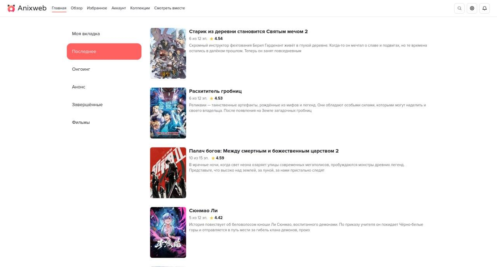

# Anixweb

[Русский](README.md)

> This project is not affiliated with the Anixart developers and is currently in open beta. Some features may be unstable or unavailable.

Anixweb is an unofficial web client for the Anixart mobile app, featuring a custom video player, Anime4K upscaling, and watch rooms.



## Key features

- Custom video player with [Anime4K](https://github.com/bloc97/anime4k) upscaling support[^1]
- Watch parties in private and public rooms
- Sign-in and registration with an Anixart account
- Lists, collections, favorites, and watch history
- Episode progress tracking
- Search, filters, and franchise browsing
- Synchronization with the mobile app[^3]
- Light and dark themes[^2]
- Image proxying when Anixart servers are unavailable in your region

## Local setup

```bash
git clone https://github.com/imnottimaq/anixart-web.git
cd anixart-web
npm install
# Build the website
npm run build
# Start the local development server
npm run dev
```

## Episode downloads and offline use

The player can save direct MP4 files and compatible, completed HLS episodes. Downloads are limited to 256 MiB; this bounds file size, not total browser memory use. Encrypted or live HLS, separate audio playlists, and timeline discontinuities are not supported. If a source is incompatible, choose another source or quality.

The production app caches its interface for offline reloads after installation completes. Catalog requests, account data, room messages, and streamed video still require a connection. New interface versions activate after all tabs using the previous version are closed and the app is reopened.

## Limitations

- Some features require an Anixart account
- App availability directly depends on the availability of the Anixart API
- Some features of the official app have not yet been implemented
- Future maintenance and development are not guaranteed
- Registration may not work for email addresses hosted by some non-standard email providers

## Feedback

Found a bug or a missing feature, or want to suggest an improvement? Open an [issue](https://github.com/imnottimaq/anixart-web/issues "issue") or create a pull request.

## License

License information is available in the [LICENSE](LICENSE) file.

[^1]: For stable upscaling, a Chromium-based browser and an RTX 2060, RX 480, or more powerful GPU are required.
[^2]: The app was originally optimized for the light theme, so you may encounter issues when using the dark theme.
[^3]: Synchronization does not include the “My tab” section, episode watch progress, or the selected theme.
